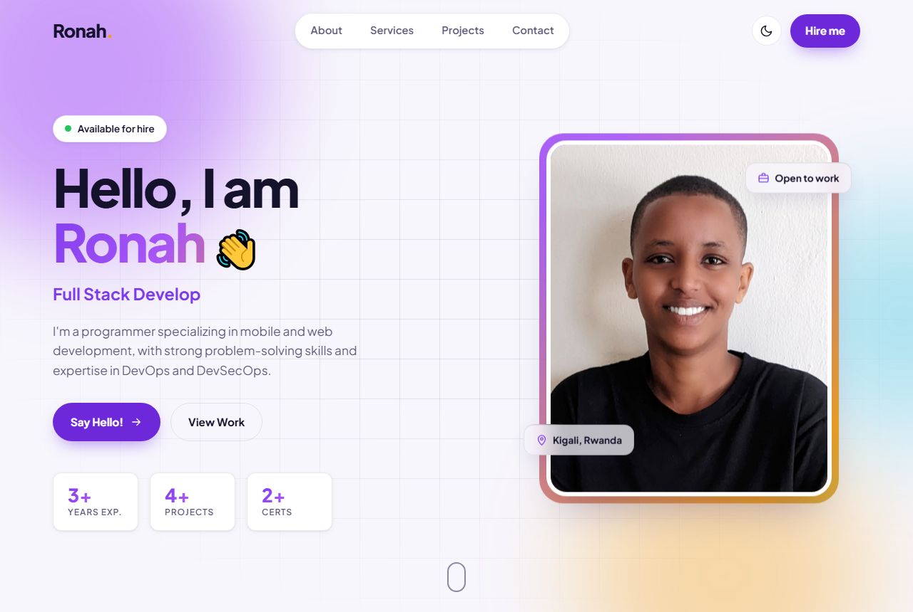
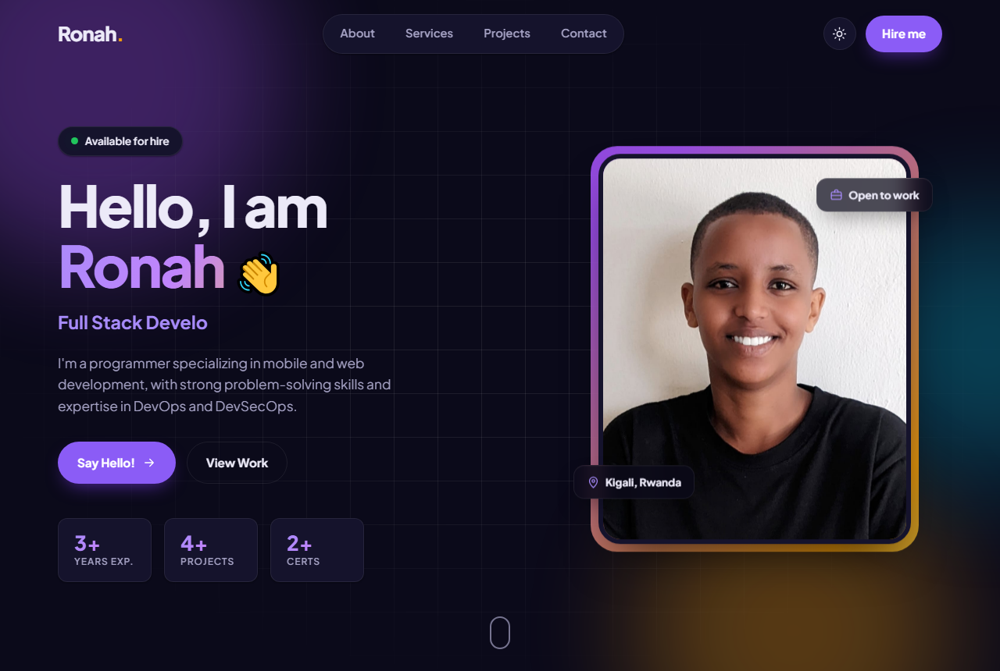
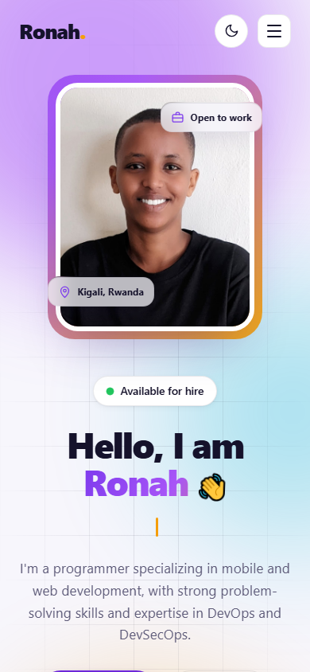
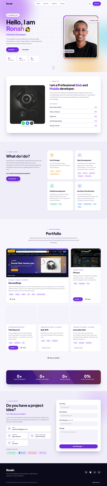

# Ronah — Developer Portfolio

The personal portfolio of **Apophia Ronah (KATUSHABE Apophia)**, a full-stack web and mobile developer and IT student at the University of Rwanda, based in Kigali. It introduces who I am and what I do, shows my projects and lets visitors contact me.

**Live site:** https://portfolio-ronahs-projects.vercel.app



<details>
<summary>More screenshots (dark mode, mobile, full page)</summary>

| Dark mode | Mobile |
| --- | --- |
|  |  |



</details>

## Features

- **Modern, responsive design** that works from small phones to wide desktops
- **Dark / light mode** toggle that remembers your choice (and follows your system setting the first time)
- **Tasteful motion**: sections reveal as you scroll, a typewriter headline, animated skill bars and counters, line icons that draw themselves in, and hover effects on cards and buttons. All motion is turned off for visitors who choose *reduce motion* in their system settings.
- **Projects section** with a picture, short description, tech tags and links to the live site and the source code
- **Contact form** with validation that opens the visitor's email app with the message filled in, plus WhatsApp, LinkedIn, Instagram and GitHub links

## Featured projects

| Project | What it is | Links |
| --- | --- | --- |
| **SecureShop** | Secure Node.js/Express e-commerce app: 2FA, CSRF protection, CSP, an audit log and 55 security tests, with a modern storefront | [Code](https://github.com/Apophiah/SecureShop) |
| **FitTrack** | Fitness tracker for workouts, activity and goals | [Live](https://fit-track-gamma-nine.vercel.app) · [Code](https://github.com/Apophiah/Fit-track) |
| **Think Beyond** | Future Regret Simulator for exploring possible futures before big decisions | [Live](https://apophiathink-beyond.vercel.app) · [Code](https://github.com/Apophiah/Think-Beyond) |
| **Bulk SMS** | UI concept for a bulk SMS marketing service | — |
| **Innovation Hub** | UI concept for a community innovation hub | — |

## Tech stack

- [React 19](https://react.dev) + [TypeScript](https://www.typescriptlang.org)
- [Vite](https://vite.dev) for the dev server and build
- Plain CSS with custom properties (design tokens) for theming — no UI framework
- `IntersectionObserver` for scroll-reveal animations
- ESLint (typescript-eslint, react-hooks)
- Deployed on [Vercel](https://vercel.com)

## Run it locally

You need [Node.js](https://nodejs.org) 20 or newer.

```bash
git clone https://github.com/Apophiah/Portfolio.git
cd Portfolio/my-react-ts-app
npm install
npm run dev        # http://localhost:5173
```

Other scripts:

```bash
npm run lint       # check the code with ESLint
npm run build      # type-check and build to dist/
npm run preview    # serve the production build locally
```

## Project structure

```
my-react-ts-app/
├── index.html               # page shell, fonts, theme set before first paint
├── public/favicon.svg
└── src/
    ├── App.tsx              # page layout and section order
    ├── index.css            # design tokens (light/dark), buttons, reveal animations
    ├── hooks/useReveal.ts   # scroll-reveal
    ├── data/profile.ts      # contact details and social links
    ├── assets/              # photo and project images
    └── components/
        ├── Header/          # sticky nav, mobile menu, theme toggle
        ├── Hello/           # hero with typewriter
        ├── proffessional/   # about me and skill bars
        ├── WhatDoIdo/       # services
        ├── Portfolio/       # project cards
        ├── Services/        # animated stats band
        ├── ContactMe/       # contact details and form
        ├── Footer/
        └── Icons/           # inline SVG icons
```

## Contact

- Email: [apophiaron85@gmail.com](mailto:apophiaron85@gmail.com)
- LinkedIn: [apophia-ronah](https://linkedin.com/in/apophia-ronah)
- GitHub: [@Apophiah](https://github.com/Apophiah)
